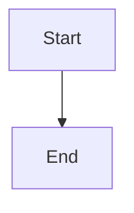

# Test Prompt: Rare Formats

Generate one response that reproduces every construct below, in this order. Keep the markdown syntax. Do not wrap the whole answer in one fence.

## Footnotes
The boiling point needs a citation[^rare].

[^rare]: Measured at standard pressure, 100 degrees Celsius.

## Task list and strikethrough
- [x] Calibrated the scale
- [ ] Recheck the blank
The previous label was ~~obsolete~~ and should not be used.

## Autolinks, bare URLs, and a markdown link
Autolink: <https://example.com/rare-autolink>
Bare URL: https://example.com/rare-bare-url/with/a/long/path
See the [lab notes](https://example.com/rare-docs) for the procedure.

## Inline HTML
First line.<br>Second line after an explicit break.
The ion is written Na<sup>+</sup> in running text.
<details><summary>Instrument note</summary>The cuvette was rinsed twice.</details>

## Nested blockquote with a list and code
> Outer observation from the bench.
>
> > - nested aliquot
> > - nested blank
> >
> > ```js
> > const nested = true
> > ```

## Table with alignment, inline math, and a pipe
| left | center | right | pipe |
| :--- | :---: | ---: | :--- |
| $\alpha$ | $x^2$ | $1$ | a \| b |

## Wide table
| c1 | c2 | c3 | c4 | c5 | c6 | c7 | c8 |
| --- | --- | --- | --- | --- | --- | --- | --- |
| 1 | 2 | 3 | 4 | 5 | 6 | 7 | 8 |

## Mermaid fence


## Chemistry and display environments
KaTeX on this site does not load the mhchem extension, so this must still be attempted:

$\ce{H2O}$ and $\ce{SO4^{2-}}$

$$
\begin{cases}
x & \text{if } x \ge 0 \\
-x & \text{if } x < 0
\end{cases}
$$

$$
\begin{aligned}
x + y &= 5 \\
2x - y &= 1
\end{aligned}
$$

Boxed: $\boxed{E = mc^2}$

Unicode inside text: $\text{温度 25°C}$

## Emoji, RTL, and CJK
Status emoji: ✅ and 🧪.
Arabic: مرحبا بالعالم
Chinese: 你好世界
Japanese: こんにちは

## Overflow
Unbroken token: UNBROKENxxxxxxxxxxxxxxxxxxxxxxxxxxxxxxxxxxxxxxxxxxxxxxxxxxxxxxxxxxxxxxxxxxxxxxxxxxxxxxxxxxxxxxxxxxxxxxxxxxxxxxxxxxxxxxxxxxxxxxxxxxxxxxxxxxxxxxxxxxxxxxxxxxxxxxxxxxxxxxxxxxxxxxxx
Long URL: https://example.com/rare-unbroken-url/aaaaaaaaaaaaaaaaaaaaaaaaaaaaaaaaaaaaaaaaaaaaaaaaaaaaaaaaaaaaaaaaaaaaaaaaaaaaaaaaaaaaaaaaaaaaaaaaaaaaaaaaaaaaaaaaaaaaaaaaaaaaaaaaaaaaaaaaaaaaaaaaaaaaaaaa

```text
LONGCODELINE = "xxxxxxxxxxxxxxxxxxxxxxxxxxxxxxxxxxxxxxxxxxxxxxxxxxxxxxxxxxxxxxxxxxxxxxxxxxxxxxxxxxxxxxxxxxxxxxxxxxxxxxxxxxxxxxxxxxxxxxxx"
```

## Dollar amounts beside math
The fare is $12 beside $E=mc^2$.
